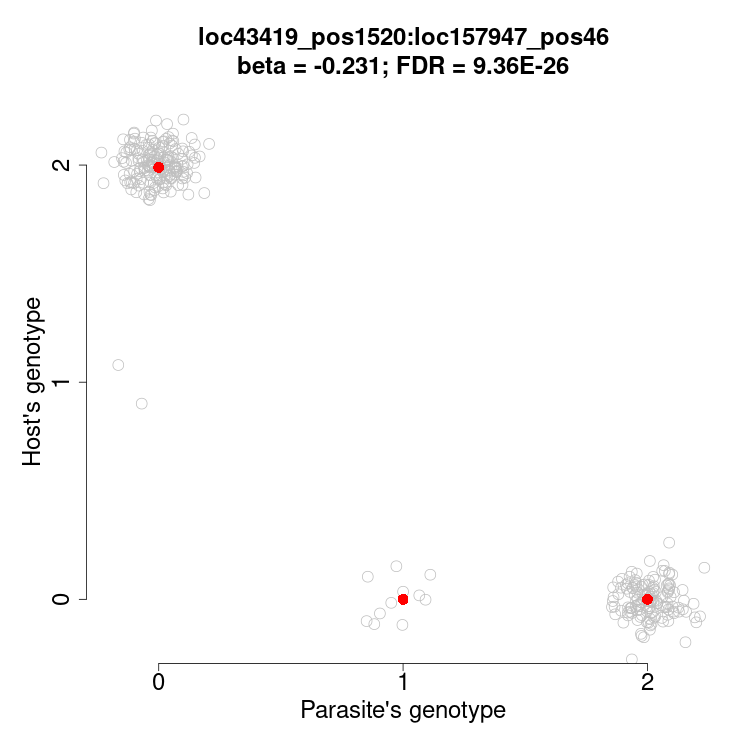
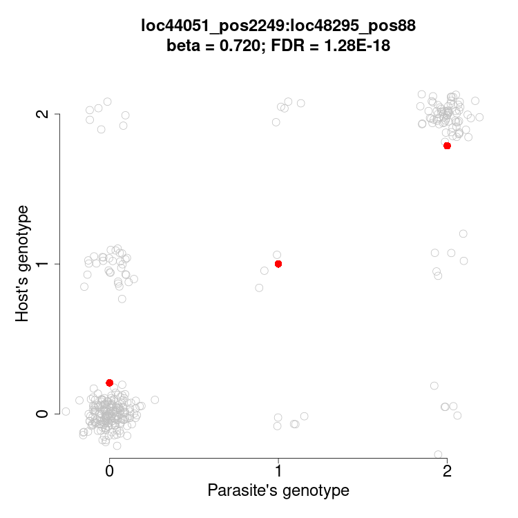
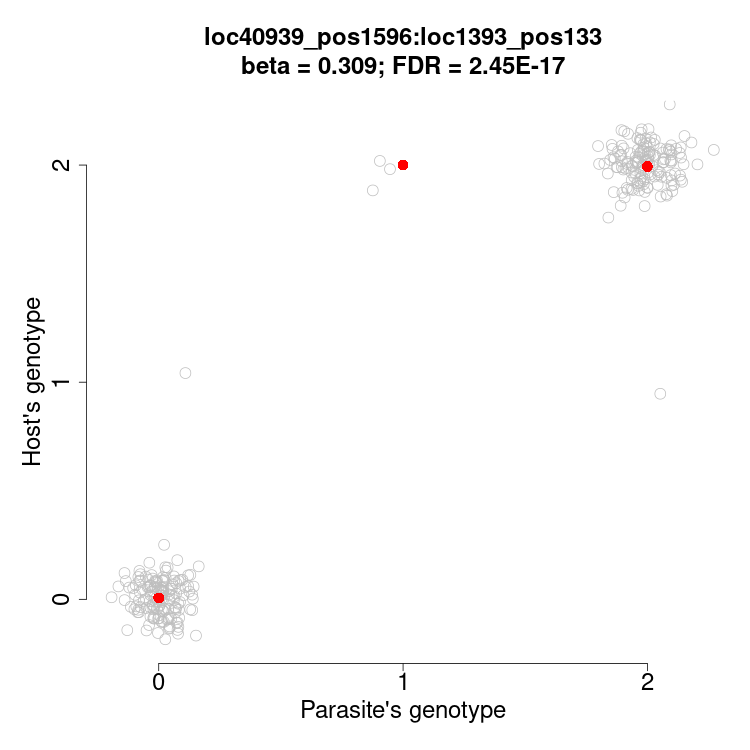

# Descripción de los datos
Se ha realizado un estudio de *asociación co-genómica* (co-GWAS) entre una muestra de 195 peces y 383 de sus parásitos intestinales. Los peces fueron genotipados en 11746 SNPs, y los parásitos en 1591 SNPs. El co-GWAS consiste en realizar un test de asociación estadística entre cada pareja de SNPs de los parásitos y de los peces, para determinar si los parásitos con un determinado genotipo en algún SNP tienen predilección por infectar peces de un determinado genotipo en alguno de sus SNPs. En la figura @fig-associacions se representan tres casos significativos, como muestra de lo que se busca en un co-GWAS.

:::{#fig-associacions layout-ncol=3}







Los genotipos del parásito y de su hospedador se representan como número de veces que aparece el alelo menos frecuente en el genotipo, y puede ser 0, 1 o 2. Se ha añadido ruido aleatorio a los puntos para apreciar el número de infecciones de cada caso. Los puntos rojos representan los genotipos medios de los hospedadores de cada genotipo del parásito. En dos de estos ejemplos el alelo menor del parásito es claramente dominante, mientras que en el otro, su efecto es aditivo.
:::

El co-GWAS es parecido a una serie de GWAS convencionales en los que los genotipos del hospedador se asignan como *fenotipos extendidos* a sus parásitos. Y entonces se ajustan modelos lineales del tipo $\mathbf{y} = \mathbf{G}\beta_G + \mathbf{X}\beta_X + \mathbf{e}$, donde $\mathbf{y}$ es el vector de genotipos de los hospedadores de los 383 parásitos en un SNP; $\mathbf{G}$ es el vector de genotipos de los 383 parásitos en uno de sus 1591 SNPs; $\mathbf{X}$ es la matriz con los interceptos y las covariables; y $\mathbf{e}$ es el error. 

Los datos originales con los que se realizó el co-GWAS (excepto las covariables, para simplificar) estan comprimidos en `input.tar.gz`, que contiene los archivos siguientes:

- `host.vcf`: Genotipos de todos los hospedadores en los 11746 SNPs en [formato VCF](https://en.wikipedia.org/wiki/Variant_Call_Format).
- `para.vcf`: Genotipos de los parásitos en sus 1591 SNPs en VCF.
- `HS.txt`: Matriz de unos y ceros que indica a qué hospedador infectaba cada parásito.

El co-GWAS se ha realizado con el programa [`plink2`](https://www.cog-genomics.org/plink/2.0/) [@Chang2015]. Los resultados del co-GWAS están comprimidos en `output.tar.gz` y contienen 11746 archivos (uno por cada SNP del hospedador), de 1591 líneas cada uno (una línea por cada SNP del parásito). La identidad del SNP del hospedador al que corresponden los resultados de un archivo está codificada en el nombre del archivo. Todos los archivos de resultados están nombrados siguiendo el mismo esquema. Por ejemplo: el archivo `para.loc178120_pos580.C.T.glm.linear` contiene los resultados para el SNP del hospedador `loc178120_pos580`, cuyos alelos menor y mayor son citosina (C) y timina (T) respectivamente. El identificador del SNP del hospedador permite relacionar estos resultados con los genotipos de los hospedadores en `host.vcf`.

Los archivos de resultados son tabulares. La primera línea contiene los nombres de las columnas, introducidos por `#`. Las 16 columnas de los archivos cuyos nombres terminan en `.linear` son las siguientes:

- CHROM, POS: Cromosoma (de hecho, cóntigo o *scaffold*) del parásito y posición donde se encuentra el SNP.
- ID: Identificador de l'SNP.
- REF: Alelo presente en el genoma de referencia del parásito.
- ALT: Alelo alternativo (o los alelos alternativos si hubiera más, pero no es el caso).
- PROVISIONAL_REF?: Indicador de que el alelo REF podria no ser el de referencia por motivos técnicos.
- A1: Alelo contado en la regresión.
- OMITTED: El otro alelo.
- A1_FREQ: Frecuencia de A1.
- TEST: Identificador del tipo de test aplicado.
- OBS_CT: Número de individuos con datos para este SNP.
- BETA: Coeficiente de regresión $\beta_G$ estimado para A1.
- SE: Error estándar de BETA.
- T_STAT: Estadístico *t* (BETA / SE).
- P: Valor *p* del test.
- ERRCODE: código de error de la regresión (".", si no hay error).

Pero atención: en algunos SNPs del hospedador sólo se han observado dos genotipos entre los 195 peces, y automáticamente se ha ajustado un modelo logístico en lugar de uno lineal. En estos casos, el archivo de salida tiene el sufijo `.logistic.hybrid` en lugar de `.linear`. Y en lugar de *BETA* tiene la columna *OR* (*odds ratio*), en lugar de *SE* tiene *LOG(OR)\_SE*, en lugar de *T_STAT* tiene *Z_STAT* y además tiene una columna adicional *FIRTH* que indica si se ha aplicado la regresión de Firth o no.

# Objetivos de la práctica

1. Prepara los datos en una carpeta de trabajo con esta estructura:

```
.
├── datos
│   ├── cogwas
│   │   ├── para.loc0_pos6.T.G.glm.linear
│   │   ├── para.loc10000_pos63.A.G.glm.linear
│   │   ├── para.loc100013_pos614.T.C.glm.linear
│   │   ├── para.loc100045_pos30.T.A.glm.linear
│   │   ...
│   │
│   ├── host.vcf
│   ├── HS.txt
│   └── para.vcf
└── resultados
    └── script.sh
```

Donde `resultados/script.sh` (o cualquier otro nombre de archivo en la carpeta de resultados) sea el *script* ejecutable donde guardas las órdenes necesarias para completar el ejercicio. Puedes crear más de un ejecutable, por ejemplo uno para Bash y el otro para Python.

2. Realizar un análisis exploratorio de los datos para confirmar la adecuada comprensión de los mismos y su consistencia. Mediante comandos básicos de Bash en el terminal o bien con Python se pueden obtener los resultados siguientes:

  - Número de archivos de resultados y el número de líneas por archivo.
  - Número de SNPs del hospedador en que se realizó una regresión logística en lugar de lineal.
  - Qué códigos de error aparecen en la columna ERRCODE, y con qué frecuencia.
  - Los identificadores de hospedadores y parásitos en `HS.txt` coinciden con los identificadores correspondientes en `host.vcf` y `para.vcf`.
  - No hay en los resultados ningún SNP que no esté incluido en `host.vcf` o en `para.vcf`.
  
3. Reunir en una misma tabla final todos los resultados de co-GWAS, con al menos una columna más con el identificador del SNP del hospedador al que se refiere cada resultado.

4. Añadir a la tabla final las coordenadas genómicas (cromosoma y posición) de los SNPs del hospedador.

5. Transformar la matriz `HS.txt` en una tabla de dos columnas: identificador del parásito e identificador del hospedador correspondiente.

6. Pensar qué sería interesante hacer con todos estos datos, y qué estrategia seguirías para conseguirlo.
