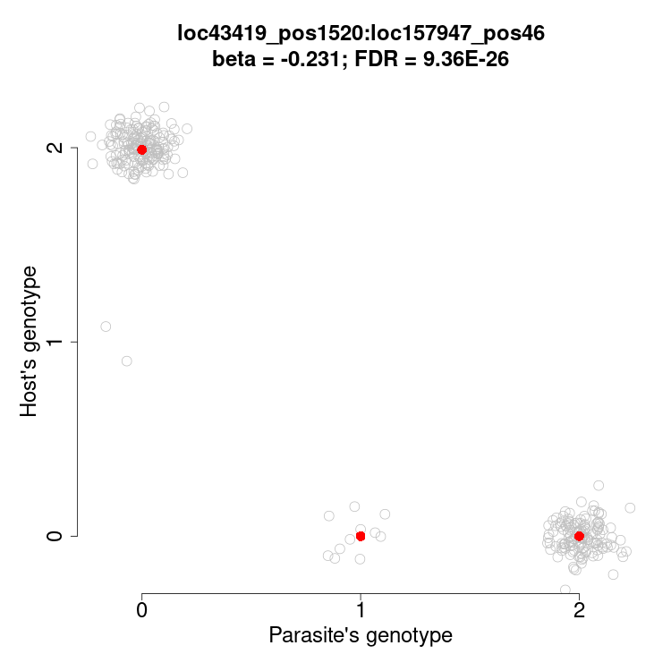
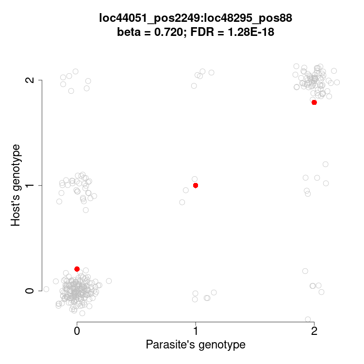
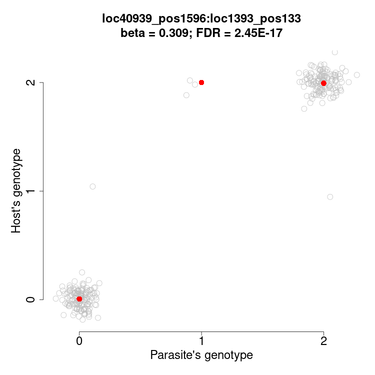

# Descripció de les dades
S'ha realitzat un estudi d'*associació co-genòmica* (co-GWAS) entre una mostra de 195 peixos i 383 dels seus paràsits intestinals. Els peixos havien sigut genotipats en 11746 SNPs i els seus paràsits, en 1591 SNPs. El co-GWAS consistix en realitzar un test d'associació estadística entre cada parell d'SNPs del paràsit i de l'hoste, per determinar si els paràsits amb un determinat genotip en algun SNP tenen predilecció per infectar peixos d'un determinat genotip en algun dels seus SNPs. En la figura @fig-associacions es representen tres casos significatius, com a mostra del que es busca amb un co-GWAS.

:::{#fig-associacions layout-ncol=3}







Els genotips del paràsit del seu hoste es representen com a nombre de vegades que l'al·lel menys freqüent apareix al genotip, que pot ser 0, 1 o 2. S'ha afegit una mica de soroll aleatori als punts perquè s'aprecie millor el nombre d'infeccions de cada combinació de genotips. Els punts rojos representen els genotips mitjans dels hostes per a cada genotip del paràsit. En dos d'aquests exemples l'al·lel menor és clarament dominant, i en l'altre té un efecte additiu.
:::

El co-GWAS és semblant a una sèrie de GWAS convencionals en què els genotips de l'hoste s'assignen com a *fenotips* dels seus paràsits. I aleshores s'ajusten models lineals del tipus $\mathbf{y} = \mathbf{G}\beta_G + \mathbf{X}\beta_X + \mathbf{e}$, on $\mathbf{y}$ és el vector de genotips dels hostes dels 383 paràsits en un SNP; $\mathbf{G}$ és el vector de genotips dels 383 paràsits en un dels seus 1591 SNPs; $\mathbf{X}$ és la matriu amb els interceptes i les covariables; i $\mathbf{e}$ és l'error residual.

Les dades originals amb què es va realitzar el co-GWAS (excepte les covariables, per simplificar) estan comprimits en `input.tar.gz`, que conté els arxius següents:

- `host.vcf`: Genotips de tots els hostes en els 11746 SNPs en [format](https://en.wikipedia.org/wiki/Variant_Call_Format).
- `para.vcf`: Genotips dels paràsits en els seus 1591 SNPs en VCF.
- `HS.txt`: Matriu d'uns i zeros que indica a quin hoste infectava cada paràsit.

El co-GWAS es va realitzar amb el programa [plink2](https://www.cog-genomics.org/plink/2.0/) [@Chang2015]. Els resultats del co-GWAS estan comprimits en `output.tar.gz` i contenen 11746 arxius (un per cada SNP de l'hoste), de 1591 línies cada un (una línia per cada SNP del paràsit). La identitat de l'SNP de l'hoste al qual corresponen els resultats d'un arxiu està codificada en el nom de l'arxiu. Tots els arxius de resultats estan nomenats seguint el mateix esquema. Per exemple, l'arxiu `para.loc178120_pos580.C.T.glm.linear` conté els resultats per a l'SNP `loc178120_pos580` de l'hoste, els al·lels menor i major del qual són citosina (C) i timina (T) respectivament. L'identificador de l'SNP de l'hoste permet relacionar aquests resultats amb els genotips dels hostes en `host.vcf`.

Els arxius de resultats són taules amb columnes separades per tabuladors. La primera línia comença amb el símbol `#` i conté els noms de les columnes. Les 16 columnes dels arxius `*.linear` són les següents:

- CHROM: Cromosoma (de fet, *contig* o *scaffold*) on es troba l'SNP del paràsit.
- POS: Posició del cromosoma (*contig* o *scaffold*) on es troba l'SNP del paràsit.
- ID: Identificador de l'SNP del paràsit.
- REF: Al·lel de l'SNP que apareix al genoma de referència.
- ALT: L'altre al·lel (o els altres si n'hi haguera més, però no és el cas).
- PROVISIONAL_REF?: Indicador de què l'al·lel REF podria no ser el de referència per motius tècnics.
- A1: Al·lel comptat a la regressió.
- OMITTED: L'altre al·lel.
- A1_FREQ: Freqüència d'A1.
- TEST: Identificador del test estadístic.
- OBS_CT: Nombre d'individus amb dades amb els quals s'ha realitzat la regressió.
- BETA: Coeficient de regressió $\beta_B$ estimat per a A1.
- SE: Error estàndard de BETA.
- T_STAT: Estadístic *t* (BETA / SE).
- P: Valor *p* de l'estadístic.
- ERRCODE: Codi d'error de la regressió (".", si no hi ha error).

Pero atenció: en alguns SNPs del hoste només s'han observat dos genotips entre els 195 peixos, i automàticament s'ha ajustat un model logístic en lloc d'un model lineal. En aquests casos, l'arxiu d'eixida té el sufix `.logistic.hybrid` en lloc de `.linear`. I en lloc de *BETA* conté la columna *OR* (*odds ratio*); en lloc d'*SE* té *LOG(OR)\_SE*; en lloc de *T_STAT* té *Z_STAT*; i a més té una columna addicional *FIRTH* que indica si s'ha aplicat la regressió de Firth o no.

# Objetius de la pràctica

1. Prepara les dades en una carpeta de treball amb aquesta estructura:

```
.
├── dadeds
│   ├── cogwas
│   │   ├── para.loc0_pos6.T.G.glm.linear
│   │   ├── para.loc10000_pos63.A.G.glm.linear
│   │   ├── para.loc100013_pos614.T.C.glm.linear
│   │   ├── para.loc100045_pos30.T.A.glm.linear
│   │   ...
│   │
│   ├── host.vcf
│   ├── HS.txt
│   └── para.vcf
└── resultats
    └── script.sh
```

On `resultats/script.sh` (o qualsevol altre nom d'arxiu en la carpeta de resultats) siga l'*script* executable on guardes les ordres necessàries per completar l'exercici. Pots crear més d'un executable, per example un per Bash i l'altre per Python.

2. Realitzar una anàlisi exploratòria de les dades per confirmar l'adequada comprensió dels mateixos i la seua consistència. Mitjançant ordres de Bash al terminal o bé amb Python, es poden obtenir els resultats següents:

  - Nombre d'arxius de resultats i nombre de línies per arxiu.
  - Nombre d'SNPs de l'hoste en què s'ha realitzat una regressió logística en lloc de lineal
  - Quins codis d'error apareixen a la columna ERRCODE, i amb quina freqüència.
  - Els identificadors dels hostes i dels paràsits en `HS.txt` coincidixen amb els identificadors corresponents en `host.vcf` i `para.vcf`.
  - No hi ha cap SNP als resultats que no estiga inclòs en `host.vcf` o en `para.vcf`.
  
3. Reunir en una mateixa taula tots els resultats de co-GWAS, amb almenys una columna més amb l'identificador de l'SNP de l'hoste al qual es refereix cada resultat.

4. Afegir a la taula final les coordenades genòmiques (cromosoma i posició) dels SNPs de l'hoste.

5. Transformar la matriu `HS.txt` en una taula de dues columnes: identificador del paràsit i identificador de l'hoste corresponent.

6. Pensar què seria interessant fer amb totes aquestes dades, i quina estratègia seguiries per aconseguir-ho.
